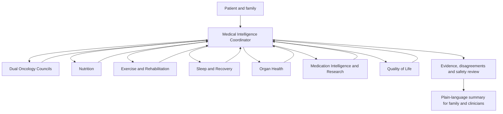

# Medical AI Council 360° — The Big Picture

## Why we're building this

When someone has cancer, different people often look at different pieces of their health. Treatment matters, but so do nutrition, sleep, medications, strength, organ health, and day-to-day quality of life. Our idea is to help families see more of that picture in one place.

We're exploring a phone-based AI companion that brings together specialized research perspectives, shows where they agree or disagree, and helps patients and families prepare informed conversations with their healthcare professionals.

**This is a high-level architecture and community discussion document, not a clinical product or a release of our private implementation.**

## The proposed architecture

## What the eight parts are intended to do

1. **Medical Intelligence Coordinator** — Connects questions, responses, and follow-ups across the system.
2. **Dual Oncology Councils** — Looks at cancer treatments and research from two separate perspectives, preserving disagreements rather than forcing agreement.
3. **Nutrition Council** — Considers nutrition, hydration, appetite, weight, and muscle preservation.
4. **Exercise & Rehabilitation Council** — Considers mobility, strength, and functional recovery.
5. **Sleep & Recovery Council** — Considers sleep, breathing-related concerns, fatigue, and recovery.
6. **Organ Health Council** — Considers information relating to the lungs, heart, kidneys, liver, and blood.
7. **Medication Intelligence & Molecular Research** — Explores medication safety questions and published research, including drug repurposing, for professional evaluation.
8. **Quality of Life Council** — Gives patients' experiences and caregivers' observations a place in the overall picture.

## How we'd like it to feel

A family asks a question in everyday language. The system identifies which areas are relevant, collects separate perspectives, tracks their supporting sources and uncertainties, and produces a clear summary to discuss with healthcare professionals. Important safety concerns would require appropriate human escalation.

The goal isn't eight chatbots talking at once. It's a useful, understandable view of the whole person.

## Where the project stands

The team reports having built and individually tested early modules and run preliminary coordination tests privately. **This document is not proof of those results.** The integrated patient-facing product, independent safety assessment, clinical validation, and real-world deployment are not complete. Any public demo will be labeled separately and tested before release.

## What we'd love help thinking through

We welcome feedback on the architecture, usability, accessibility, evidence quality, privacy, safety testing, and how to make useful information understandable to families. Please use GitHub Issues for suggestions, **without posting personal medical information**.

**Medical AI Council 360° is not a diagnostic tool, treatment recommendation system, emergency service, or substitute for qualified medical care.** No benefit to cancer outcomes has been established.
